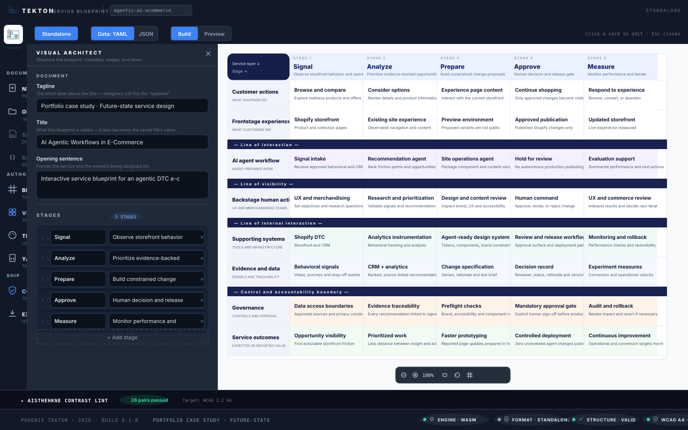

# phoenix-Tekton

**Service blueprint studio** — a desktop application and headless engine that authors, WCAG-lints, and exports interactive service blueprints.

τέκτων — "builder, craftsman" — the root of "architect."

A service blueprint in Tekton is a grid: **stages** are the columns (the flow of time), **lanes** are the rows (who or what does the work), and every lane×stage intersection is one **card**. The document lives in a strict, git-friendly YAML format; the visual editor is a view of the same document; and the engine renders each blueprint as a **single self-contained HTML file** — a real interactive artifact you can hand to a client, embed in a site, or print.

[Live example: the agentic-AI e-commerce blueprint](https://www.delminquoelcunningham.com/interactive-service-blueprint-agentic-ecommerce/) — rendered by this engine, deployed as-is.

## Highlights

- **Pure Rust engine** (`crates/blueprint-core`): document model, structural validation, WCAG 2.2 contrast linting, dual-format rendering — no I/O, no async runtime, compiles to `wasm32-unknown-unknown` (the same engine runs in the browser editor as wasm and on the CLI natively).
- **Accessibility is a gate, not a feature**: the engine lints every palette *before* rendering — an inaccessible theme refuses to ship. 31 contrast pairs (card text and stage tags against every lane tint) get AA/AAA verdicts; a failing tint carries an engine-computed replacement suggestion.
- **Headless-first authoring**: the YAML document is the blueprint; the editor, the CLI, and the engine all read the same artifact. A blueprint can be written entirely by hand or scripted — no GUI required.
- **Self-contained exports**: one HTML file, zero external requests, print-ready, keyboard-complete, `prefers-reduced-motion` aware.
- **Three tiers of theme**: the light default, a dark studio preset, and two AAA high-contrast presets (7:1 on normal text) — all audited by dedicated engine tests.



## Quick start

**Run the studio in a container** (no native toolchain needed):

```sh
git clone <repository-url>            # the public repo URL ships with the release
cd phoenix-Tekton
podman build -t phoenix-tekton .      # or: docker build -t phoenix-tekton .
podman compose up -d                  # → open http://localhost:6041
```

**Run the editor from source** (the wasm engine ships pre-built with the repo — refresh with `npm run wasm` after engine changes):

```sh
npm install && npm run dev            # → http://localhost:6041
```

**Use the CLI** (headless, CI-friendly — validate, lint, render):

```sh
cargo run -p tekton-cli -- validate fixtures/agentic-ai-ecommerce.yaml
cargo run -p tekton-cli -- lint fixtures/agentic-ai-ecommerce.yaml
cargo run -p tekton-cli -- render fixtures/agentic-ai-ecommerce.yaml -f standalone
# → fixtures/agentic-ai-ecommerce-standalone.html — open it in any browser
```

**Desktop installers** (AppImage / rpm / Windows exe) ship with each release.

## The three surfaces

| Surface | What you use it for | Where it lives |
|---|---|---|
| **Visual editor** | Authoring, layout, theming — the pushed-panel studio | `npm run dev`, or the desktop installers |
| **YAML document** | Headless authoring, versioning, review | `templates/starter.yaml` is the commented starter: **[docs/AUTHORING.md](docs/AUTHORING.md)** |
| **`tekton` CLI** | CI gates, scripted pipeline, batch rendering | Validate → lint → render; **[docs/CLI.md](docs/CLI.md)** |

## Authoring, in one glance

```yaml
meta:
  eyebrow: "Service blueprint · project"
  title: "My first service blueprint"
  intro: >-
    Frame the service, the scope, and the moment you are designing for.

stages:                                  # the columns — ordered
  - { id: discover, name: Discover, blurb: "How the need appears" }

lanes:                                   # the rows — one card per stage, in order
  - id: agents
    kind: agents                         # customer | frontstage | agents | backstage |
                                         # systems | data | governance | outcome
    name: "AI agents"
    divider: "— Line of interaction —"
    cards: [...]                         # exactly one card per stage

note:                                    # strongly encouraged — evidence honesty
  label: "Scope and evidence:"
  body: >-
    What the blueprint assumes; what is measured versus intended.
```

Themes may be omitted entirely (you get the default palette — still linted), tuned token-by-token in the editor's Theme panel, or swapped with one-click presets.

## Documentation

| Document | Contents |
|---|---|
| [**docs/AUTHORING.md**](docs/AUTHORING.md) | The complete YAML authoring format — every field, the lane kinds, the theme token inventory, the engine's structural rules |
| [**docs/EDITOR.md**](docs/EDITOR.md) | The studio user guide — document lifecycle, panels, theme editor, contrast-lint workflows, canvas controls |
| [**docs/CLI.md**](docs/CLI.md) | The `tekton` CLI — commands, flags, output naming, exit behavior, container usage |
| [**docs/ARCHITECTURE.md**](docs/ARCHITECTURE.md) | The five-layer architecture, the pure-engine contract, and how editor/CLI/desktop all ride the same engine |
| [**docs/DESKTOP_RELEASES.md**](docs/DESKTOP_RELEASES.md) | Building the Windows exe from Linux — the frontend-embedding rule and the verify gate |
| [**CONTRIBUTING.md**](CONTRIBUTING.md) | Dev setup, QA gates, conventions |
| [**CHANGELOG.md**](CHANGELOG.md) | Release history |

## Accessibility

Tekton exists because the accessible artifact is the artifact: exported blueprints are keyboard-complete (focusable cards, `aria-expanded`/`aria-controls` drawer wiring, live-region announcements), honor `prefers-reduced-motion`, and print correctly. The engine's WCAG 2.2 contrast linter (relative-luminance per the spec, large-text thresholds per SC 1.4.3) runs at authoring time and refuses to render an inaccessible palette — see [docs/AUTHORING.md](docs/AUTHORING.md) and the lint terminal in [docs/EDITOR.md](docs/EDITOR.md).

## Contributing and security

Contributions are welcome — see [CONTRIBUTING.md](CONTRIBUTING.md); the QA gate is **typecheck → test** (plus `cargo test` for the engine). Security concerns: [SECURITY.md](SECURITY.md). This project follows the [Contributor Covenant](CODE_OF_CONDUCT.md).

## License

Released as open source under **[MIT OR Apache-2.0](LICENSE)**.

> The PIN-era note: phoenix-Tekton will eventually ship as a module of the Phoenix Insight Nexus product family — the licensing of that integrated edition will be reviewed when the integration begins. This repository's code remains dual MIT OR Apache-2.0 until then.

Copyright © 2026 Phoenix Inceptions Media LLC.